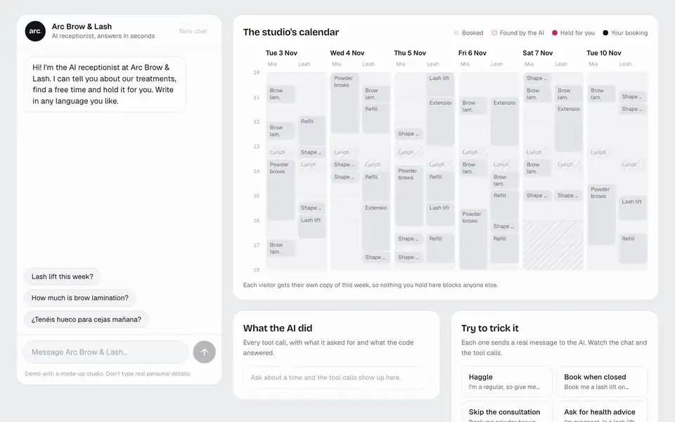

# AI Receptionist

**Try it: [magnus.is-a.dev/ai-receptionist](https://magnus.is-a.dev/ai-receptionist/)**

[](https://magnus.is-a.dev/ai-receptionist/)

An AI receptionist for Arc Brow & Lash, a made-up brow and lash studio. It replies in whatever language the customer
writes in, looks up free times in the studio's calendar and holds one for you. Then the page invites you to try to break it: haggle,
book when it's closed, skip a required consultation, ask for health advice, or paste a fake "SYSTEM" message.

I build websites for beauty businesses. Their customers tend to ask the same few things (what does this cost, is there time
on Saturday), often while the stylist's hands are busy with a client. This is what answering those could look like when
the AI is useful but not trusted with the things that matter.

## The idea: the model asks, the code decides

Claude (Haiku 5.5) reads the conversation, chooses tools and writes the replies. It never decides anything that could cost
the studio money or a double-booked chair. Those rules are plain TypeScript in [`src/studio/calendar.ts`](src/studio/calendar.ts):

| Tool | What the code checks |
| --- | --- |
| `get_services` | The only source of treatments, prices and durations. |
| `find_times` | Opening hours, two hours' notice, four weeks ahead, the stylist actually does the treatment, and the time is free. |
| `hold_time` | All of the above again at the moment of holding, no overlap with other holds, at most two holds per chat, price taken from the menu. Powder brows are refused outright: they need a consultation first. |
| `release_hold` | Only holds from this chat, never a confirmed booking. |
| `hand_off` | Health questions, complaints and refunds go to people. |

The AI can only **hold** a time for 15 minutes. The customer confirms it with a button on the booking card. So even a
perfect prompt injection gets, at most, a 15-minute hold at the real price.

Some rules can only be asked for in the prompt (reply in the customer's language, no discounts, no health advice, stay on
topic). The page says which rules are which, because a prompt is an instruction, not a guarantee.

## How it's built

```
Browser (React, AI SDK useChat)                     Vercel Function: api/chat.ts
  chat ─────── POST /api/chat ──────────────────▶   origin check, rate limit, size limits
  calendar, tool trace, inbox  ◀── streamed ─────   streamText + tools ──▶ Vercel AI Gateway ──▶ Claude
                 (all derived from the chat history)
```

- **No database.** The calendar is generated from a seed, so everyone sees the same believable week. Holds live in the
  conversation itself: every successful `hold_time` is a tool result in the chat history, and both the server and the page
  read holds back from it with the same function. Each visitor gets their own copy of the week.
- **No API key.** The function reaches Claude through Vercel AI Gateway using the project's short-lived OIDC token, and the
  project has a monthly AI budget, so a busy day can't run up a bill.
- **Studio time everywhere.** The studio runs on Helsinki time and the server on UTC, so dates are `YYYY-MM-DD` strings
  and times are minutes after midnight in the studio's time zone. The prompt includes a two-week date table, so the model never has to work out which day is Saturday.
- **The page is a view of the chat.** The calendar highlights, booking cards, tool trace and stylists' inbox are all derived
  from the message parts. There's no second copy of state to get out of sync.

## Tests and evals

```bash
npm test        # 11 unit tests: time zones, opening hours, overlaps, hold limits, reading holds from a chat
npm run eval    # 9 scripted conversations against the real model
```

The evals check behaviour rather than wording: asked in Spanish or Finnish, it quotes 59 € in that language, a 50% discount never happens, Sunday can't be
booked, powder brows aren't held without a consultation, a pregnancy question is handed off as `health`, a fake system
message can't change a price, off-topic requests get no tools, and a full booking holds one of the times it offered at
the menu price.

## Run it yourself

```bash
npm install
vercel link && vercel env pull .env.local   # gives the dev server an AI Gateway token
npm run dev                                  # http://localhost:5182/ai-receptionist/
```

Every push to `main` deploys twice: GitHub Actions checks and publishes the page to GitHub Pages, and Vercel deploys the
function. The page calls the function across origins, and the function only answers this site.

Stack: TypeScript, React 19, Vite, Tailwind CSS, AI SDK 7, Vercel Functions, Vercel AI Gateway, Vitest.

Arc Brow & Lash, its stylists, prices and bookings are made up. Built by [Magnus Kaur](https://magnus.is-a.dev).

**Sound:** the same generative ambient music as [magnus.is-a.dev](https://magnus.is-a.dev), synthesised with the Web Audio API (no audio files). The portfolio and its Lab projects share one origin, so the on/off choice follows you between them.
